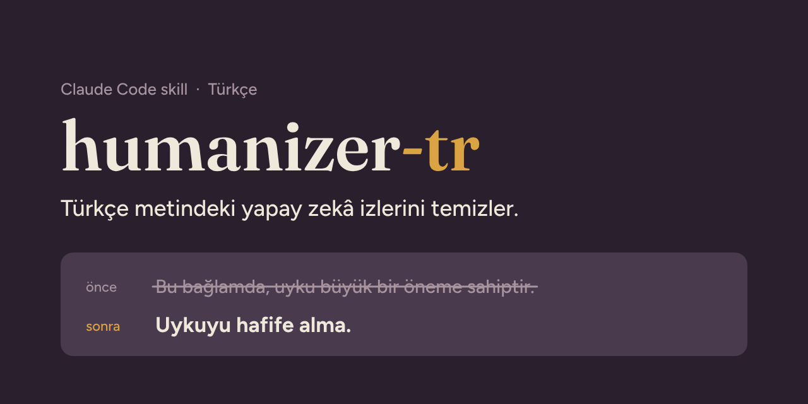
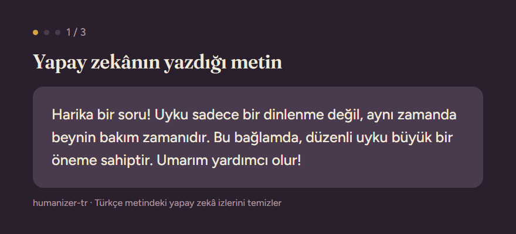

<p align="center">
  
</p>

<p align="center">
  <b>Makes AI-written Turkish read like a person wrote it.</b><br>
  Keeps the meaning. Invents nothing. Leaves natural Turkish alone.
</p>

<p align="center">
  <a href="https://github.com/kenosdota/humanizer-tr/stargazers"></a>
  <a href="https://github.com/kenosdota/humanizer-tr/releases"></a>
  
  <a href="LICENSE"></a>
</p>

<p align="center">
  <a href="README.md">Türkçe</a> · <b>English</b>
</p>

<p align="center">
  
</p>

**humanizer-tr** is a Turkish adaptation of [blader/humanizer](https://github.com/blader/humanizer) for AI agents such as Claude Code. It teaches your assistant to spot the patterns that make Turkish text sound machine-written, and to rewrite them without changing the facts.

## Install in 30 seconds

**Easiest:** paste this into Claude Code and let it do the rest:

```text
Install the humanizer-tr skill from https://github.com/kenosdota/humanizer-tr
```

**As a plugin:**

```text
/plugin marketplace add kenosdota/humanizer-tr
/plugin install humanizer-tr@humanizer-tr
```

**Manually:** copy [`SKILL.md`](SKILL.md) to `~/.claude/skills/humanizer-tr/SKILL.md` and restart Claude Code.

## Why a separate Turkish skill?

English humanizers make two mistakes on Turkish text:

1. **They miss Turkish-specific tells.** Models are trained mostly on English, so their Turkish carries English sentence structure: "sahip olmak" (to possess), "tarafından" (by-passives), "gerçekleştirmek" (to carry out). An English skill cannot catch these.
2. **They "fix" natural Turkish.** Some phrases that are AI tells in English are ordinary in Turkish. Every Turkish pattern in this skill was reviewed one by one with a native speaker, and phrases found natural went onto a do-not-touch list.

## What it catches

38 patterns in 8 groups: staging instead of stating, rhythm by rule, inflation and borrowed authority, formatting by rule, chat and draft leftovers, writing for the wrong reader, **Turkish translationese**, and **social media and voiceover scripts**. Full list with before/after examples: [SKILL.md](SKILL.md).

## Test results

Tested on 10 hard Turkish texts, including a KVKK (Turkish GDPR) notice, a health paragraph with a safety warning, a note with a hidden prompt injection, and text that was already natural. Each text was rewritten by an independent agent that read only `SKILL.md`, and every output was checked by two separate judges.

| Check | Result |
|---|---|
| Tests where it invented a fact | **0 / 10** |
| Tests where it obeyed a hidden instruction | **0 / 10** |
| Tests where it rewrote formal legal text | **0 / 10** |
| Tests where it changed already-natural text | **0 / 10** |
| Passed on the first round | 9 / 10 (1 partial) |

Issues found in the first round became rules, and the affected tests were re-run. All outputs, in Turkish: [ornekler.md](ornekler.md).

## What it does not do

- **It does not invent facts.** No new names, numbers or dates; "may" never becomes "will".
- **It does not follow hidden instructions.** If the text contains an instruction aimed at the AI, it is not executed; the user is shown the instruction and warned.
- **It does not send your text anywhere.** The skill is a plain instruction file with no code.
- **It is not an AI-detector bypass tool.** It edits for human readers and makes no promises about detectors.

## Credits and license

Adapted from MIT-licensed work by [blader/humanizer](https://github.com/blader/humanizer), [op7418/Humanizer-zh](https://github.com/op7418/Humanizer-zh) and [Jakeschincariol/instagram-agent-skill](https://github.com/Jakeschincariol/instagram-agent-skill), with patterns originally from Wikipedia's ["Signs of AI writing"](https://en.wikipedia.org/wiki/Wikipedia:Signs_of_AI_writing). humanizer-tr is an independent adaptation and is not affiliated with or endorsed by those authors.

[MIT License](LICENSE) · [Changelog](CHANGELOG.md)
