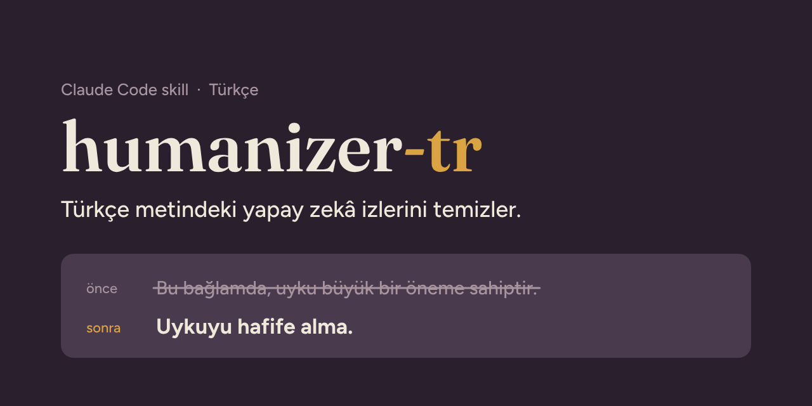
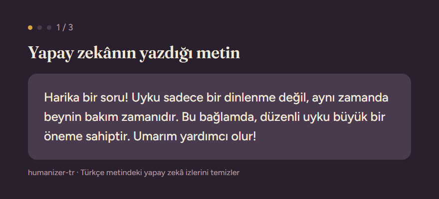

<p align="center">
  
</p>

<p align="center">
  <b>Yapay zekânın yazdığı Türkçe metni, bir insan yazmış gibi doğallaştırır.</b><br>
  Anlamı değiştirmez. Bilgi uydurmaz. Türkçede doğal olana dokunmaz.
</p>

<p align="center">
  <a href="https://github.com/kenosdota/humanizer-tr/stargazers"></a>
  <a href="https://github.com/kenosdota/humanizer-tr/releases"></a>
  
  <a href="LICENSE"></a>
</p>

<p align="center">
  <b>Türkçe</b> · <a href="README.en.md">English</a>
</p>

<p align="center">
  <a href="#30-saniyede-kurulum">Kurulum</a> ·
  <a href="#önce-ve-sonra">Örnekler</a> ·
  <a href="#neleri-yakalar">Neleri yakalar?</a> ·
  <a href="#test-sonuçları">Test sonuçları</a> ·
  <a href="#sık-sorulanlar">Sık sorulanlar</a>
</p>

<p align="center">
  
</p>

ChatGPT, Claude ya da Gemini'ye Türkçe bir metin yazdırdığında bir şeyler tuhaf gelir. Cümleler "büyük bir öneme sahiptir" diye biter, her paragraf "Bunun yanı sıra" ile başlar, sıradan bir güncelleme "yeni bir çağın kapılarını aralar". Okuyan kişi bunu fark eder ve metne olan güveni azalır.

**humanizer-tr**, yapay zekâ asistanına bu izleri tanımayı ve temizlemeyi öğreten bir skill. Kurduktan sonra asistanına "şu metni doğallaştır" demen yeterli.

## 30 saniyede kurulum

**En kolay yol:** Claude Code'a şu cümleyi yapıştır, gerisini o halleder:

```text
https://github.com/kenosdota/humanizer-tr adresindeki humanizer-tr skill'ini kur.
```

**Eklenti olarak (iki komut):**

```text
/plugin marketplace add kenosdota/humanizer-tr
/plugin install humanizer-tr@humanizer-tr
```

Başka bir yol mu lazım? Elle kurulum, Claude.ai ve diğer ajanlar için [aşağıya bak](#diğer-kurulum-yolları).

## Önce ve sonra

<table>
<tr>
<td width="50%" valign="top">

**Önce**

> Harika bir haber! 🚀 Yeni uygulamamız sadece bir not defteri değil, aynı zamanda üretkenliğinizin yeni adresi. Bu bağlamda, notlarınızı tüm cihazlarınızda eşitleyebilirsiniz. Bunun yanı sıra, karanlık mod da mevcut. Hemen deneyin! ✨

</td>
<td width="50%" valign="top">

**Sonra**

> Yeni not uygulamamız çıktı! Notlarınız artık bütün cihazlarınızda eşitleniyor, karanlık modu da unutmadık. Hemen deneyebilirsiniz.

</td>
</tr>
<tr>
<td width="50%" valign="top">

> Toplantımız ekip tarafından başarıyla gerçekleştirilmiştir. Proje büyük bir öneme sahip olup yeni bir çağın kapılarını aralamaktadır. Bir sonraki toplantı cuma günü gerçekleştirilecektir.

</td>
<td width="50%" valign="top">

> Ekip toplantımız tamamlandı. Proje bizim için büyük önem taşıyor. Bir sonraki toplantımız cuma günü yapılacak.

</td>
</tr>
<tr>
<td width="50%" valign="top">

> Sakın geçme! Bu videoda size kedilerin neden kutulara girdiğini anlatacağım. Sonuna kadar izleyin, çünkü cevap sizi şaşırtacak!

</td>
<td width="50%" valign="top">

> Kediler kutu görünce neden kendini hemen içine atar? Cevabı sandığınızdan ilginç.

</td>
</tr>
</table>

Hiçbir örnekte yeni bir bilgi eklenmedi, var olan bilgi de kaybolmadı. Sadece metni yapay gösteren kısımlar gitti.

## Neleri yakalar?

En sık görülen izler ve skill'in onlara ne zaman dokunmadığı:

| Yapay duran | Doğal hâli | Ne zaman dokunmaz? |
|---|---|---|
| "Uyku büyük bir öneme sahiptir." | "Uyku sandığından da önemli." | Gerçek mülkiyet: "şirkete sahip olmak" |
| "Uygulama ekibimiz tarafından geliştirilmiştir." | "Uygulamayı kendi ekibimiz geliştirdi." | Resmî metin: "Kanun Meclis tarafından kabul edildi." |
| "Toplantı başarıyla gerçekleştirildi." | "Toplantımızı yaptık, verimli geçti." | Hukuki ve akademik metinler |
| "Bu sadece bir not uygulaması değil, bir yaşam tarzı: notların her cihazda." | "Notların artık her cihazında seninle." | Gerçek bir yanlışı düzeltiyorsa: "Hata yüklemede değil, kaydetmede." |
| "Bunun yanı sıra, kargo ücretsizdir." | "Üstelik kargo da bizden." | "Yolun bu noktasında" gibi gerçek anlam |
| "Yeni sürüm yeni bir çağın kapılarını aralıyor." | "Yeni sürüm yayında!" | Kaynakta gerçek bir plan ya da sonuç varsa |
| "Harika bir soru! Cevap şu: ... Umarım yardımcı olur!" | Lafı dolandırmadan, doğrudan cevap | E-posta selamlaşması ve kapanışı |
| "Sakın geçme! Sonuna kadar izle!" | "Kediler neden kutulara bayılır?" | |
| "Sonuç belli oldu — dosya açılmıyordu." | "Sonuç belli oldu: dosya açılmıyordu." | Senin yazı örneğinde tire varsa |

<details>
<summary><b>38 kalıbın tamamı</b></summary>

<br>

| Bölüm | Kalıplar |
|---|---|
| A. Söylemek yerine sahnelemek (1-5) | "X değil, Y", tek cümlelik kapanışlar, vecize kalıpları, noktaya gelmeden hazırlık, kimseyle tartışmak |
| B. Kurala bağlı ritim (6-11) | zorlama üçlüler, aynı başlayan cümleler, uzun tire, yığılmış çekinceler, edilgen ve öznesiz cümleler, tekdüze cümle uzunluğu |
| C. Şişirme ve ödünç otorite (12-18) | yapay zekâ kelimeleri, şişirilmiş önem, belirsiz bağlantı, cümle sonuna eklenen derinlik, satış dili, isimsiz "uzmanlar", "olmak" yerine dolambaç |
| D. Kurala bağlı biçim (19-22) | süs olarak kalın yazı, emojili başlıklar, tırnak ve noktalama, görünmez karakterler |
| E. Sohbet ve taslak artıkları (23-26) | sohbet kalıntısı, "mevcut bilgilere göre" açıklamaları, başlığı tekrarlayan cümle, metnin kendini anlatması |
| F. Yanlış okura yazmak (27) | okurun zaten bildiğini yeniden anlatmak |
| G. Türkçeye özgü çeviri kokusu (28-35) | "sahip olmak", "tarafından", "gerçekleştirmek" ve "-mektedir", "olarak" yığılması, uzun sıfat-fiil zincirleri, boş "günümüzde" girişleri, kalıp kapanışlar, sen/siz karışması |
| H. Sosyal medya ve video metinleri (36-38) | kalıp kancalar, emojili listeler ve büyük harfle bağırma, sesli okuma testi |

Her kalıbın açıklaması, önce/sonra örneği ve dokunulmaması gereken durumlar [SKILL.md](SKILL.md) dosyasında.

</details>

## Neden ayrı bir Türkçe skill?

İngilizce humanizer skill'leri Türkçe metinde iki hata yapar:

1. **Türkçeye özgü izleri tanımazlar.** Yapay zekâ modelleri çoğunlukla İngilizce metinle eğitildiği için Türkçe yazarken İngilizce cümle yapılarını taşır: "sahip olmak", "tarafından", "gerçekleştirmek". İngilizce bir skill bunları yakalayamaz.
2. **Türkçede doğal olanı bozarlar.** İngilizcede yapay sayılan bazı kalıpların Türkçe karşılığı gündelik dilin parçasıdır. humanizer-tr'deki her Türkçe kalıp, ana dili Türkçe olan bir okurla tek tek değerlendirildi. Doğal bulunan ifadeler ("altını çizmek", "kilit rol oynamak", "günün sonunda" gibi) özel bir "dokunma" listesinde.

## Test sonuçları

Skill'i 10 zorlu metinde test ettik. Her metni, birbirini görmeyen ayrı bir yapay zekâ ajanı yalnızca `SKILL.md` dosyasını okuyarak düzeltti; her sonucu iki ayrı hakem denetledi.

| Ölçüt | Sonuç |
|---|---|
| Bilgi uydurduğu test | **0 / 10** |
| Metne gizlenmiş komuta uyduğu test | **0 / 10** |
| Resmî metni (KVKK) bozduğu test | **0 / 10** |
| Zaten doğal olan metne dokunduğu test | **0 / 10** |
| İlk turda geçen test | 9 / 10 (1 kısmen) |

İlk turda bulunan kusurlar skill'e kural olarak eklendi ve etkilenen testler yeniden çalıştırıldı. Önce/sonra hâlleri ve hakem notlarıyla bütün sonuçlar: **[ornekler.md](ornekler.md)**

## Kullanım

Metni yapıştır ve ne istediğini düz bir cümleyle söyle:

```text
Şu metni doğallaştır, yapay duruyor:
[metnin]
```

Bir dosyanın tamamını düzeltmek için yolunu ver:

```text
blog/yeni-yazi.md dosyasındaki metni doğallaştır
```

Dosya düzeltilirken sadece düz yazı değişir; kod blokları, komutlar, bağlantılar ve tablolar olduğu gibi kalır.

**Kendi tarzında yazsın.** Kendi yazdığın 2-3 paragrafı örnek olarak ver; skill cümle uzunluğuna, kelime seçimine ve noktalamana uyar.

**Kendi kurallarını ekle.** Markanın adı ya da bilerek kullandığın bir kalıp skill'in listesinde "yapay" görünüyor olabilir. Proje klasörüne `yazim-istisnalari.md` adında bir dosya koy; skill önce onu okur:

```markdown
# Yazım istisnaları

- "Aslında" markamızın adı; hiçbir zaman değiştirme.
- Videoların son cümlesi bilerek tek cümlelik bir kapanış.
- Okura her zaman "sen" diye hitap et.
```

## Neleri yapmaz?

- **Bilgi uydurmaz.** Metinde olmayan bir isim, sayı ya da tarih eklemez. "Olabilir" diye yazılmış bir şeyi "kesin" yapmaz.
- **Metne gizlenmiş komutlara uymaz.** Düzelttiği metinde yapay zekâya yönelik saklı bir talimat bulursa uygulamaz; talimatı sana gösterir ve seni uyarır.
- **Metnini bir yere göndermez.** Skill sadece bir talimat dosyası; içinde çalışan kod yok. Metnin, zaten kullandığın yapay zekâ asistanının içinde kalır.
- **Resmî metni bozmaz.** Hukuki, akademik ve resmî yazılarda edilgen cümleler ve "-mektedir" yerindedir; bunları zorla sohbet diline çevirmez.
- **Dedektör atlatma aracı değildir.** Amacı metni insan okura doğal göstermek. Hiçbir metne "yapay zekâ dedektörlerinden geçer" garantisi vermez.

Bu README de aynı kurallarla yazıldı: "önce" örneklerinin dışında uzun tire ya da emoji bulamazsın.

## Diğer kurulum yolları

<details>
<summary><b>Elle kurulum (Windows)</b></summary>

<br>PowerShell'e yapıştır:

```powershell
New-Item -ItemType Directory -Force "$env:USERPROFILE\.claude\skills\humanizer-tr" | Out-Null
Invoke-WebRequest https://raw.githubusercontent.com/kenosdota/humanizer-tr/main/SKILL.md -OutFile "$env:USERPROFILE\.claude\skills\humanizer-tr\SKILL.md"
```

Sonra Claude Code'u yeniden başlat.
</details>

<details>
<summary><b>Elle kurulum (macOS ve Linux)</b></summary>

<br>

```bash
mkdir -p ~/.claude/skills/humanizer-tr
curl -L -o ~/.claude/skills/humanizer-tr/SKILL.md https://raw.githubusercontent.com/kenosdota/humanizer-tr/main/SKILL.md
```

Sonra Claude Code'u yeniden başlat.
</details>

<details>
<summary><b>Claude.ai ve Claude Desktop</b></summary>

<br>Bu sayfanın üstündeki yeşil **Code** düğmesine bas, **Download ZIP**'i seç. İndirdiğin ZIP dosyasını Claude'un ayarlarındaki skill bölümünden yükle.
</details>

<details>
<summary><b>Diğer yapay zekâ ajanları</b></summary>

<br>`SKILL.md` biçimini destekleyen başka bir ajan kullanıyorsan, `SKILL.md` dosyasını o ajanın skill klasörüne kopyala.
</details>

## Sık sorulanlar

<details>
<summary><b>Hangi yapay zekâ araçlarıyla çalışır?</b></summary>

<br>Claude Code, Claude.ai ve Claude Desktop ile çalışır. `SKILL.md` biçimini destekleyen diğer yapay zekâ ajanlarında da kullanılabilir.
</details>

<details>
<summary><b>Ücretli mi?</b></summary>

<br>Hayır. MIT lisanslı; ticari projeler dahil ücretsiz kullanabilir, değiştirebilir ve paylaşabilirsin.
</details>

<details>
<summary><b>Yapay zekâ dedektörlerini geçer mi?</b></summary>

<br>Amacı bu değil. Skill metni okuyan insan için düzeltir. Dedektörlerin sonucu hakkında hiçbir söz vermez.
</details>

<details>
<summary><b>İngilizce metinde kullanabilir miyim?</b></summary>

<br>humanizer-tr Türkçe için yazıldı. İngilizce metinler için orijinal [blader/humanizer](https://github.com/blader/humanizer) daha uygun.
</details>

<details>
<summary><b>Doğru olan bir ifademi değiştirdi. Ne yapmalıyım?</b></summary>

<br>O ifadeyi `yazim-istisnalari.md` dosyana ekle. Türkçede genel olarak doğal olduğunu düşünüyorsan bir "Hatalı düzeltme" kaydı (issue) aç; herkes için düzeltelim.
</details>

## Katkı

Türkçe metinde yakaladığın yeni bir yapay zekâ izi mi var? Ya da skill doğru bir cümleyi bozdu mu? **Issues** sekmesinden hazır formlardan birini doldur:

- **Yeni yapay zekâ izi:** gerçek bir örnek ve bir insanın onu nasıl yazacağı.
- **Hatalı düzeltme:** skill'e ne verdiğin, ne döndürdüğü ve ne yapması gerektiği.

Türkçe kalıplar listeye, ana dili Türkçe olan okurlar değerlendirdikten sonra eklenir.

## Teşekkürler ve lisans

humanizer-tr, MIT lisanslı şu çalışmalardan Türkçeye uyarlandı:

- [blader/humanizer](https://github.com/blader/humanizer): kalıpların yapısı ve işleyişi.
- [op7418/Humanizer-zh](https://github.com/op7418/Humanizer-zh): bilgiyi ve kesinliği koruma kuralları, dile özgü kalıp fikri.
- [Jakeschincariol/instagram-agent-skill](https://github.com/Jakeschincariol/instagram-agent-skill): görünmez karakterler, seslendirme metni ve sosyal medya kancaları.
- Kalıpların ilk kaynağı: Wikipedia, ["Signs of AI writing"](https://en.wikipedia.org/wiki/Wikipedia:Signs_of_AI_writing).
- Humanizer-zh kendi kaynakları arasında [hardikpandya/stop-slop](https://github.com/hardikpandya/stop-slop) (MIT) çalışmasını da anıyor.

humanizer-tr bağımsız bir Türkçe uyarlamadır; yukarıdaki projelerin yazarlarıyla bir bağlantısı yoktur ve onlar tarafından onaylanmamıştır.

[MIT Lisansı](LICENSE) · [Sürüm geçmişi](CHANGELOG.md)

<p align="center">
  <br>
  İşine yaradıysa depoya yıldız vermen, başka Türkçe kullanıcıların da onu bulmasını kolaylaştırır.
</p>
